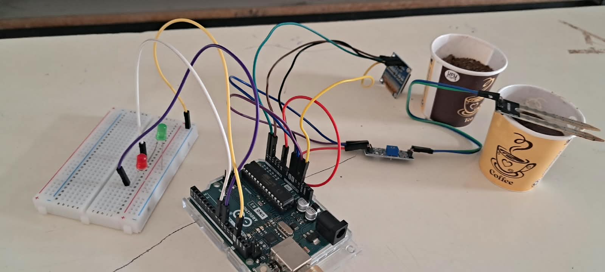

# Arduino-Based Smart Plant Health Monitoring System

An automated plant care and soil-moisture monitoring system built using an **Arduino microcontroller** and a **Soil-Moisture Sensor**. The system continuously tracks soil hydration levels to detect when a plant needs watering, prevents over-watering or underwatering, and supports efficient automated plant care.

## Key Features
* **Continuous Soil-Moisture Sensing:** Uses a soil-moisture sensor probe to measure real-time volumetric water content in the soil.
* **Threshold-Based Watering Alerts:** Automatically identifies dry soil conditions and alerts the user or triggers a watering mechanism when moisture falls below the optimal level.
* **Automated Water Management:** Prevents water wastage by ensuring plants receive water only when required.
* **Simple & Low-Power Hardware:** Built on Arduino for reliable indoor, balcony, or small-garden plant care.

## Hardware & Software Components
* **Microcontroller:** Arduino UNO / Nano
* **Sensor:** Soil-Moisture Sensor Module
* **Actuator / Indicators:** Water Pump with Relay Module / LED & Buzzer Alerts *(customize based on your setup)*
* **Software & Language:** Arduino IDE, Embedded C/C++

## How It Works
1. The **soil-moisture sensor** inserted near the plant roots measures soil conductivity and outputs an analog moisture reading to the **Arduino**.
2. The **Arduino** converts the raw analog reading into a moisture percentage and compares it against preset dry and wet thresholds.
3. When the soil becomes too dry, the system signals a low-moisture alert (or activates a water pump via relay) to water the plant.
4. Once adequate soil moisture is restored, watering stops automatically to protect plant roots from over-saturation.

## Repository Structure

- [`Smart_Plant_Monitor.ino`](https://github.com/trushatanna/Smart-plant-health-monitor./Smart_Plant_Monitor.ino) – Arduino code for soil-moisture sensing and automated watering control
- [`plant_circuit.jpg`](./plant_circuit.jpg) – Hardware wiring and prototype setup *(optional)*

### Circuit & Prototype Preview

## Author
**Trusha Tanna**  
B.E. in Electronics and Communication Engineering | Government Engineering College, Bhavnagar  
* **Portfolio:** [View Live Portfolio](https://trushatanna.github.io/)
* **Email:** trushatanna0208@gmail.com

